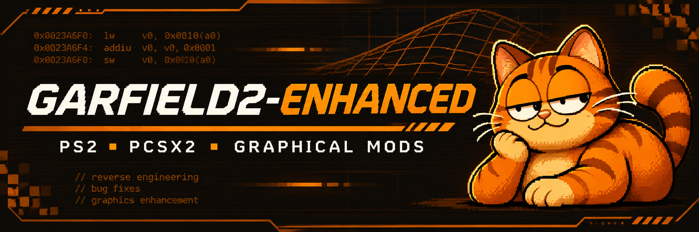
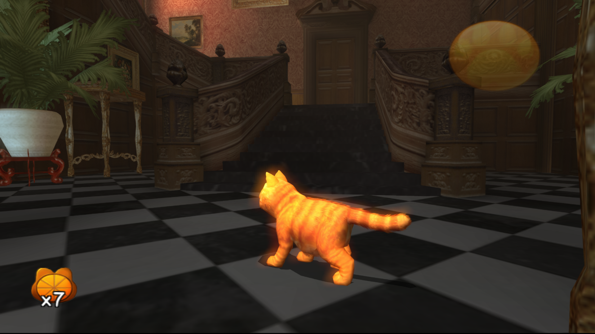
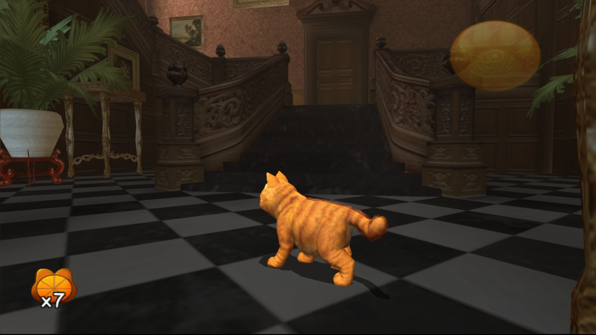
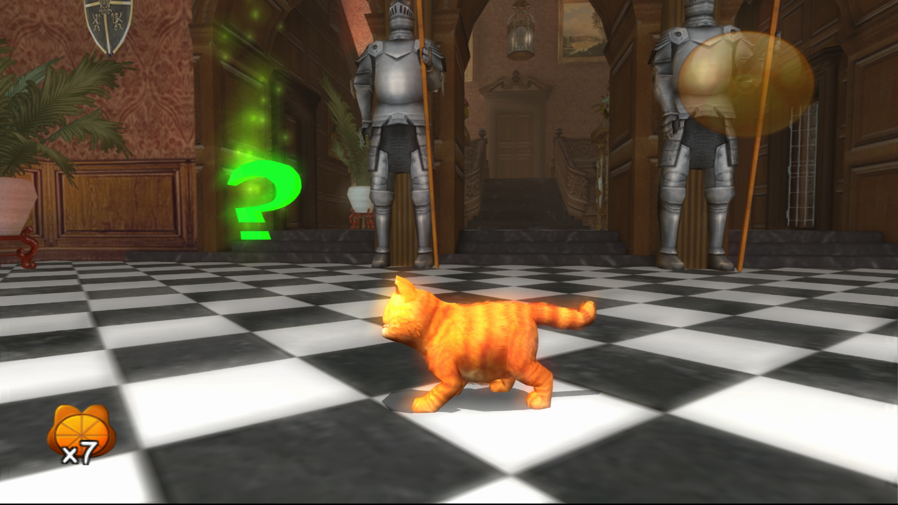
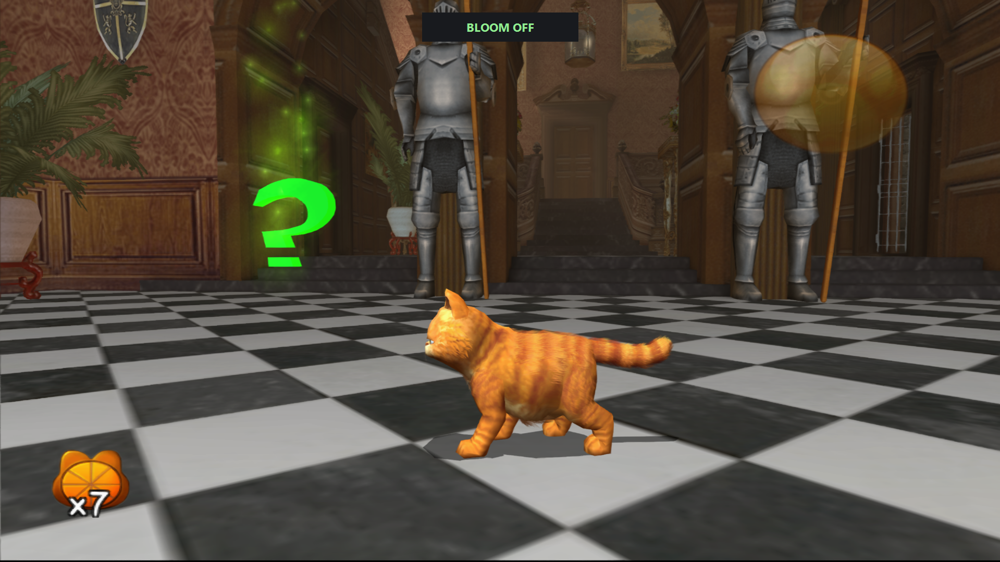
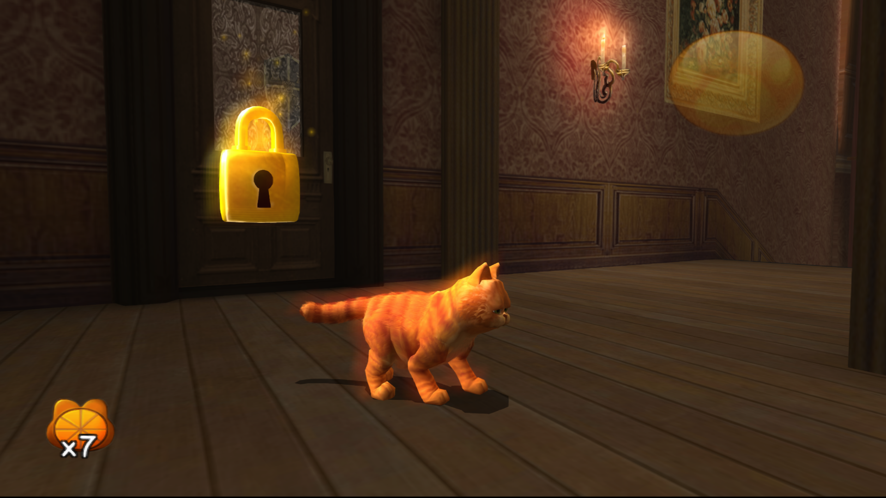
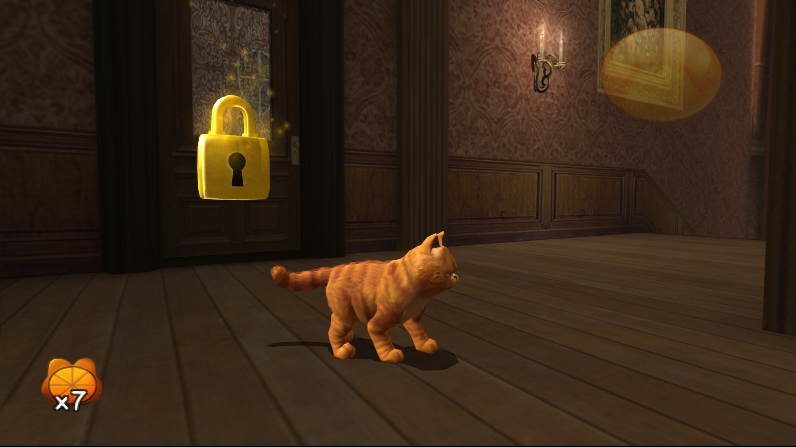

  <a href="README.md"><strong>🇺🇸 English</strong></a> · <a href="README.pt-BR.md"><strong>🇧🇷 Português (Brasil)</strong></a>

# Garfield 2 Enhanced

     

**Unofficial No Bloom patch for Garfield 2 on PlayStation 2, designed for PCSX2.**

[**Download patch**](patches/SLES-54172_627B8252.pnach) · [Installation](docs/INSTALLATION.md) · [Technical notes](docs/TECHNICAL.md) · [Compatibility](docs/COMPATIBILITY.md) · [Changelog](CHANGELOG.md) · [Visual comparisons](#visual-comparisons)

## No Bloom — Experimental v0.1

The No Bloom patch disables the targeted bloom effect, reducing distracting halos and apparent ghosting seen in the scenes tested by the project author. No gameplay issues were reported during those tests; other glow effects may be affected. This is an experimental patch, not an exhaustive compatibility guarantee.

| Compatibility | Value |
| --- | --- |
| Game | Garfield 2 (Europe) |
| Emulator | PCSX2, with per-game PNACH patch support |
| Serial | `SLES-54172` |
| CRC | `627B8252` |

## Download and installation

[Download the PNACH file](patches/SLES-54172_627B8252.pnach) (open the file and select Download raw file).

1. Check the game's serial and CRC in PCSX2 game properties.
2. Place the downloaded file in your configured PCSX2 `patches` directory. Keep the exact filename. If a local file with the same name already exists, back it up and merge only the missing No Bloom section instead of overwriting it.
3. Open the game's properties, select **Patches**, and enable **No Bloom - Experimental v0.1**.
4. Start the game from a fresh boot. To undo, disable the patch and restart the game.

See the [full installation guide](docs/INSTALLATION.md) for troubleshooting and backup instructions.

## Visual comparisons

The six screenshots below were captured by the author during gameplay, toggling the targeted effect in the same session. The images are preserved without retouching. Click any screenshot to open it at full size.

### Castle staircase

| Original — Bloom ON | Patched — Bloom OFF |
| :---: | :---: |
|  |  |

Notice the intense orange halo around Garfield in the original image. With No Bloom, the silhouette and fur are easier to distinguish.

### Armour hall

| Original — Bloom ON | Patched — Bloom OFF |
| :---: | :---: |
|  |  |

The original bloom spreads across Garfield and the bright floor tiles. The patched image shows clearer tile boundaries while the green question mark and some luminous effects remain visible.

### Locked door

| Original — Bloom ON | Patched — Bloom OFF |
| :---: | :---: |
|  |  |

The halos around Garfield, the padlock and the candlelight are reduced. The padlock and its surrounding particles remain visible.

*Note: animation poses and particles may differ between frames; these are gameplay comparisons, not pixel-perfect comparisons. The BLOOM OFF notice in the armour hall screenshot is the test tool's on-screen indicator. These results do not imply that all luminous effects are removed.*

## RetroAchievements

This project has not received official approval from RetroAchievements or PCSX2. Technical compatibility does not establish Hardcore eligibility. Do not use experimental patches for competitive achievement runs pending official guidance. See [compatibility notes](docs/COMPATIBILITY.md).

## Feedback and credits

Project maintainer: **farmarcs**. Original PNACH credit: **Garfield2 Lab (analise experimental)**. Report reproducible issues through GitHub Issues when the repository becomes public; include your PCSX2 version, renderer, serial/CRC, enabled patches and steps to reproduce.

Independent fan project. No game ISO, BIOS, original executable or extracted game assets are distributed. Licensing is pending maintainer review.
