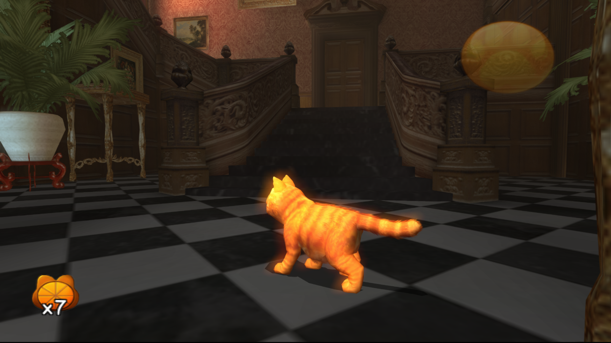
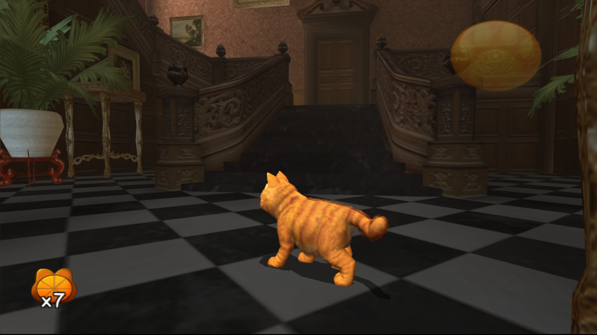
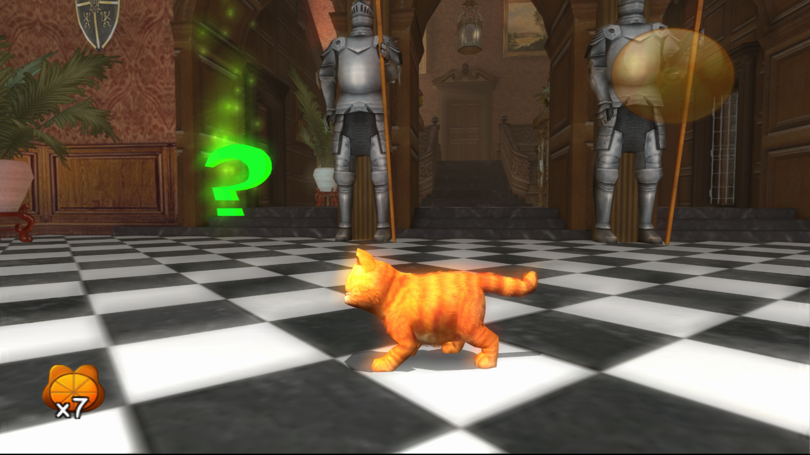
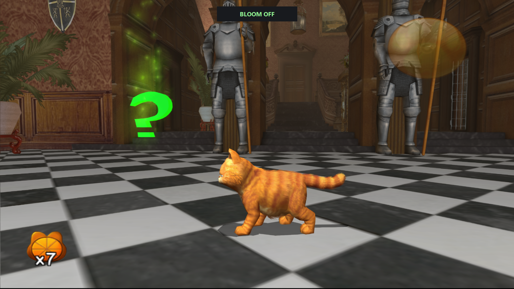
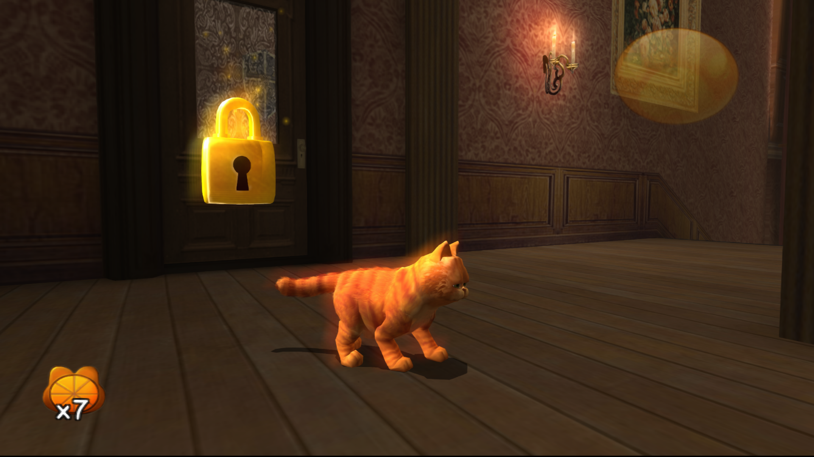
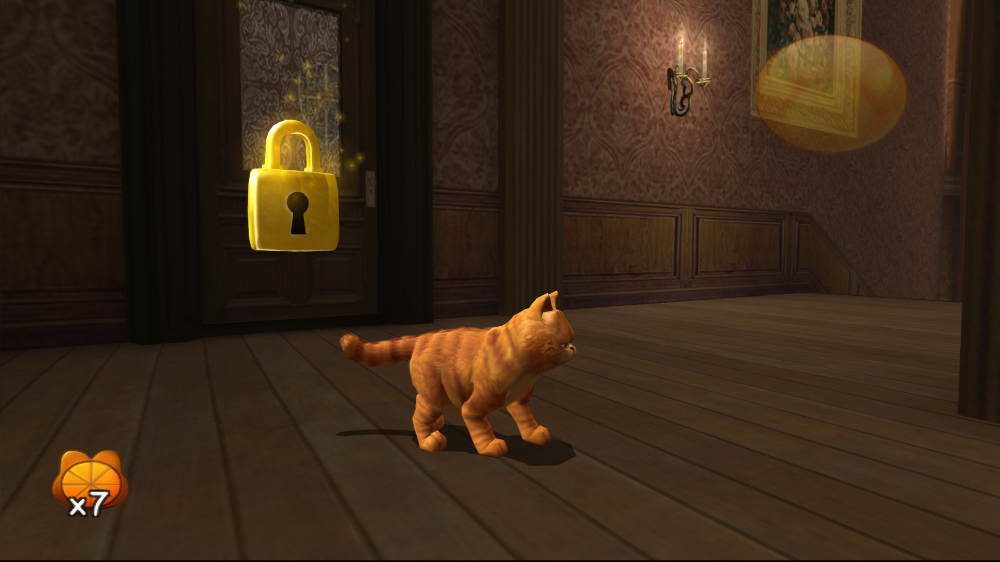

  <a href="README.md"><strong>🇺🇸 English</strong></a> · <a href="README.pt-BR.md"><strong>🇧🇷 Português (Brasil)</strong></a>

# Garfield 2 Enhanced

     

**Patch independente No Bloom para Garfield 2 de PlayStation 2, desenvolvido para o PCSX2.**

[**Baixar patch**](patches/SLES-54172_627B8252.pnach) · [Tutorial ilustrado](docs/INSTALLATION.md#português-brasil) · [Notas técnicas](docs/TECHNICAL.md) · [Compatibilidade](docs/COMPATIBILITY.md) · [Histórico](CHANGELOG.md) · [Comparações visuais](#comparações-visuais)

## No Bloom — Experimental v0.1

O patch No Bloom desativa o efeito de bloom investigado, reduzindo os halos e o ghosting aparente nas cenas testadas pelo autor. Não foram relatados problemas de jogabilidade nesses testes, mas outros efeitos de brilho podem ser afetados. A validação não foi exaustiva.

| Compatibilidade | Valor |
| --- | --- |
| Jogo | Garfield 2 (Europa) |
| Emulador | PCSX2 com suporte a patches PNACH por jogo |
| Serial | `SLES-54172` |
| CRC | `627B8252` |

## Download e instalação

[Baixar o arquivo PNACH](patches/SLES-54172_627B8252.pnach) (abra o arquivo e selecione Download raw file).

1. Confirme serial e CRC nas propriedades do jogo.
2. Coloque o PNACH na pasta `patches` configurada no PCSX2, com o nome exato. Se já existir um arquivo local com o mesmo nome, faça backup e acrescente apenas a seção No Bloom ausente, sem sobrescrever os demais patches.
3. Abra as propriedades do jogo, entre em **Patches** e marque **No Bloom - Experimental v0.1**.
4. Inicie o jogo do zero. Para desfazer, desmarque o patch e reinicie o jogo.

**[Abra o tutorial ilustrado de instalação](docs/INSTALLATION.md#português-brasil)** — capturas passo a passo, instruções de backup e solução de problemas. Não é necessário utilizar ferramentas externas.

## Comparações visuais

As seis capturas abaixo foram realizadas pelo autor durante a gameplay, alternando o efeito investigado na mesma sessão. As imagens estão preservadas sem retoques. Clique em qualquer captura para abri-la em tamanho completo.

### Escadaria do castelo

| Original — Bloom ON | Com patch — Bloom OFF |
| :---: | :---: |
|  |  |

Observe o halo alaranjado intenso ao redor de Garfield na imagem original. Com o No Bloom, a silhueta e a pelagem ficam mais definidas.

### Salão das armaduras

| Original — Bloom ON | Com patch — Bloom OFF |
| :---: | :---: |
|  |  |

O bloom original se espalha sobre Garfield e os ladrilhos claros. Com o patch, os limites dos ladrilhos ficam mais definidos, enquanto a interrogação verde e alguns efeitos luminosos continuam visíveis.

### Porta com cadeado

| Original — Bloom ON | Com patch — Bloom OFF |
| :---: | :---: |
|  |  |

Os halos ao redor de Garfield, do cadeado e das velas são reduzidos. O cadeado e as partículas ao seu redor permanecem visíveis.

*Nota: as poses e partículas podem variar entre os quadros; as capturas são uma comparação visual de gameplay, não uma comparação pixel a pixel. O aviso BLOOM OFF na captura do salão das armaduras é o indicador da ferramenta de teste. Os resultados não implicam a remoção de todos os efeitos luminosos.*

## RetroAchievements

Não há homologação oficial pelo PCSX2 ou RetroAchievements. Não utilize patches experimentais para obter conquistas competitivas sem orientação oficial. Consulte as [notas de compatibilidade](docs/COMPATIBILITY.md).

## Créditos

Mantenedor: **farmarcs**. Autoria registrada no PNACH: **Garfield2 Lab (analise experimental)**. Projeto independente, sem distribuição de ISO, BIOS, executável original ou recursos extraídos do jogo.

## Licença

O código original do patch e a documentação textual original estão disponíveis sob a [licença MIT](LICENSE). Consulte o [escopo da licença e os avisos sobre terceiros](NOTICE.md#português-brasil). Capturas de tela, banner e propriedade intelectual de terceiros estão excluídos da concessão MIT.
