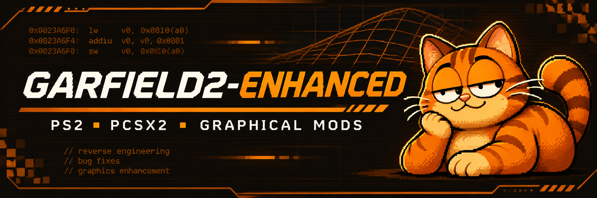

# Garfield 2 Enhanced

     

**Patch independente No Bloom para Garfield 2 de PlayStation 2, desenvolvido para o PCSX2.**

[**Baixar patch**](patches/SLES-54172_627B8252.pnach) · [Instalação](docs/INSTALLATION.md#português-brasil) · [Notas técnicas](docs/TECHNICAL.md) · [Compatibilidade](docs/COMPATIBILITY.md) · [Histórico](CHANGELOG.md) · [English](README.md)

## No Bloom — Experimental v0.1

O patch No Bloom desativa o efeito de bloom investigado, reduzindo os halos e o ghosting aparente nas cenas testadas pelo autor. Não foram relatados problemas de jogabilidade nesses testes, mas outros efeitos de brilho podem ser afetados. A validação não foi exaustiva.

| Compatibilidade | Valor |
| --- | --- |
| Jogo | Garfield 2 (Europa) |
| Emulador | PCSX2 com suporte a patches PNACH por jogo |
| Serial | `SLES-54172` |
| CRC | `627B8252` |

## Download e instalação

[Baixar o arquivo PNACH](patches/SLES-54172_627B8252.pnach) (abra o arquivo e selecione Download raw file).

1. Confirme serial e CRC nas propriedades do jogo.
2. Coloque o PNACH na pasta `patches` configurada no PCSX2, com o nome exato. Se já existir um arquivo local com o mesmo nome, faça backup e acrescente apenas a seção No Bloom ausente, sem sobrescrever os demais patches.
3. Abra as propriedades do jogo, entre em **Patches** e marque **No Bloom - Experimental v0.1**.
4. Inicie o jogo do zero. Para desfazer, desmarque o patch e reinicie o jogo.

Consulte o [tutorial completo](docs/INSTALLATION.md#português-brasil).

## Comparações visuais e compatibilidade

Imagens de antes e depois serão inseridas após a revisão de cenas equivalentes. Não há homologação oficial pelo PCSX2 ou RetroAchievements. Não utilize patches experimentais para obter conquistas competitivas sem orientação oficial.

## Créditos

Mantenedor: **farmarcs**. Autoria registrada no PNACH: **Garfield2 Lab (analise experimental)**. Projeto independente, sem distribuição de ISO, BIOS, executável original ou recursos extraídos do jogo. Licença pendente de decisão do mantenedor.
