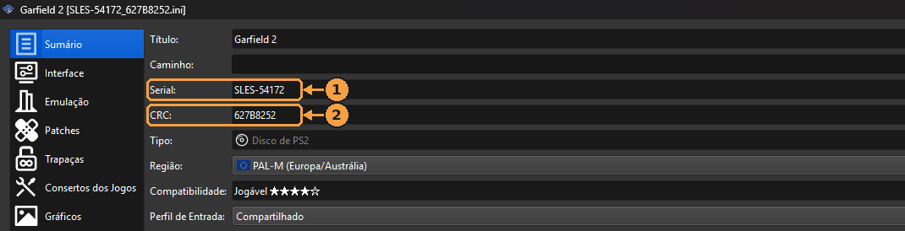
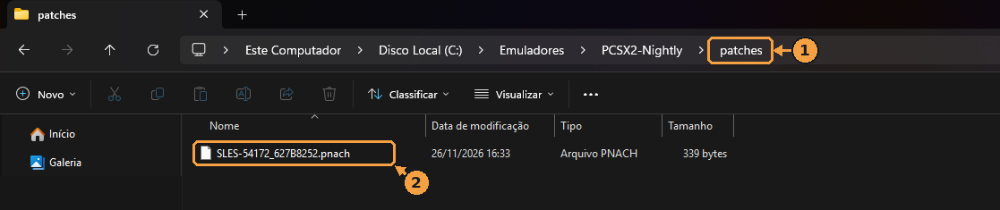
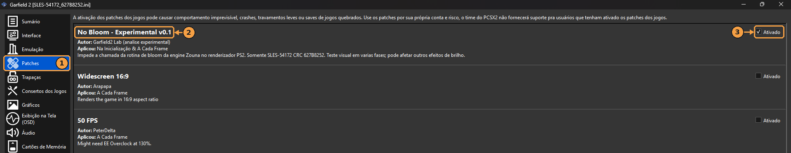
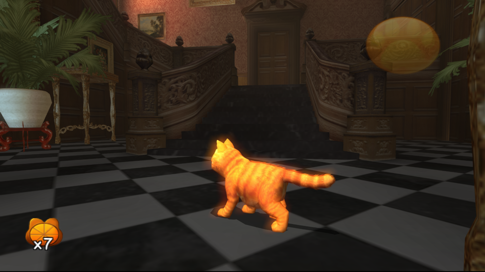
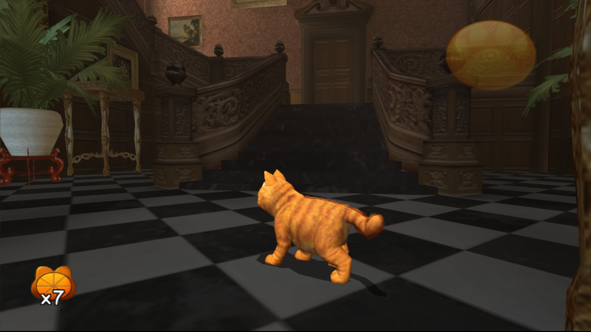

# Illustrated installation guide / Tutorial ilustrado de instalação

[English](#english) · [Português (Brasil)](#português-brasil) · [Project / Projeto](../README.md)

## English

**Requirements:** your own copy of Garfield 2 (Europe), a PCSX2 build supporting named per-game PNACH patches, and the No Bloom v0.1 file. The screenshots show PCSX2 v2.9.196 on Windows with the Brazilian Portuguese interface. Orange numbers identify the corresponding controls. No additional tool, PINE connection or PS2 Live Patch Lab is required.

### 1. Download the patch

Stop emulation. Open [the PNACH file](../patches/SLES-54172_627B8252.pnach) on GitHub and select **Download raw file**. Keep its exact filename:

`SLES-54172_627B8252.pnach`

Make sure Windows has not added a .txt extension or a duplicate-download suffix.

### 2. Check the game revision

In the PCSX2 game list, right-click Garfield 2 and open **Properties > Summary** (Propriedades > Sumário).

1. Serial: `SLES-54172`.
2. CRC: `627B8252`.

Both must match. Do not use the patch on another revision.

### 3. Find the patches directory

From the PCSX2 main window, choose **Tools > Open Data Directory** (Ferramentas > Abrir diretório de dados; wording may vary). In the opened directory, locate the folder named `patches`. If it does not exist, create it in that data directory.

Common Windows locations:

- Standard installation: `Documents\PCSX2\patches`.
- Portable installation: `patches` next to the PCSX2 executable.

Your actual data location may differ. Do not use the `cheats` or `sstates` folder, and do not modify the built-in `resources/patches.zip`.

### 4. Install the PNACH file

Copy the downloaded file into `patches`.

1. Confirm the folder is named `patches`.
2. Confirm the exact PNACH filename.

The screenshot shows an example portable setup; your path does not need to match it.

**If a local PNACH with the same name already exists:** make a backup outside the patches folder. Open both files in a text editor and append the entire missing section starting with `[No Bloom - Experimental v0.1]` to the existing file. Do not duplicate the section or overwrite existing patches. Save using the original .pnach extension.

### 5. Enable No Bloom

Return to the game list and open **Properties > Patches**. If the entry is missing, use Reload Patches (Recarregar Patches), reopen properties or restart PCSX2.

1. Open **Patches**.
2. Locate **No Bloom - Experimental v0.1**.
3. Check **Enabled** (Ativado) for No Bloom.

The other entries in the screenshot, Widescreen 16:9 and 50 FPS, are separate patches and are not needed. Leave them disabled for an isolated test. Keep achievements disabled during experimental testing; no official RetroAchievements or PCSX2 approval is claimed.

### 6. Start the game and check the result

Boot normally rather than loading a save state. Compare an affected scene with and without No Bloom, keeping the renderer and other settings constant.

| Original — Bloom ON | Patched — Bloom OFF |
| :---: | :---: |
|  |  |

See the [full visual gallery](../README.md#visual-comparisons). Other luminous effects may remain or be affected.

### 7. Disable or uninstall

Stop emulation, uncheck No Bloom and boot the game again. To uninstall, remove only the supplied file if it contains no other patches. If you merged the section, remove only that section or restore the backup if appropriate, preserving other changes.

### Troubleshooting (EN)

| Problem | What to check |
| --- | --- |
| Patch is not listed | Serial/CRC, actual patches folder, exact filename and extension; reload patches. |
| Bloom remains visible | Enabled checkbox, fresh boot and possible conflicts; test No Bloom alone. |
| Unexpected visual or gameplay changes | Disable the patch, restart and report the scene, emulator build, renderer and settings. |

See [compatibility notes](COMPATIBILITY.md).

---

## Português (Brasil)

**Requisitos:** sua própria cópia de Garfield 2 (Europa), uma versão do PCSX2 compatível com patches PNACH identificados por nome e o arquivo No Bloom v0.1. As capturas mostram o PCSX2 v2.9.196 no Windows, com interface em português. Os números em laranja identificam os controles correspondentes. Não é necessário usar ferramentas adicionais, PINE ou PS2 Live Patch Lab.

### 1. Baixe o patch

Encerre a emulação. Abra [o arquivo PNACH](../patches/SLES-54172_627B8252.pnach) no GitHub e selecione **Download raw file** (baixar arquivo bruto). Preserve o nome exato:

`SLES-54172_627B8252.pnach`

Confira se o Windows não acrescentou a extensão .txt ou um sufixo de download duplicado.

### 2. Confira a versão do jogo

Na lista de jogos do PCSX2, clique com o botão direito sobre Garfield 2 e abra **Propriedades > Sumário**.

1. Serial: `SLES-54172`.
2. CRC: `627B8252`.

Os dois valores precisam coincidir. Não utilize o patch em outra revisão.

### 3. Localize a pasta patches

Na janela principal do PCSX2, acesse **Ferramentas > Abrir diretório de dados** (Tools > Open Data Directory; o nome pode variar conforme a tradução). Dentro do diretório aberto, localize a pasta `patches`. Caso não exista, crie-a nesse diretório de dados.

Locais comuns no Windows:

- Instalação padrão: `Documentos\PCSX2\patches`.
- Instalação portátil: pasta `patches` ao lado do executável do PCSX2.

O caminho real pode variar. Não utilize as pastas `cheats` ou `sstates` e não modifique o arquivo interno `resources/patches.zip`.

### 4. Instale o arquivo PNACH

Copie o arquivo baixado para a pasta `patches`.

1. Confirme que a pasta se chama `patches`.
2. Confirme o nome exato do arquivo PNACH.

A captura mostra um exemplo de instalação portátil; seu caminho não precisa ser igual.

**Se já existir um PNACH local com o mesmo nome:** faça um backup fora da pasta patches. Abra os dois arquivos em um editor de texto e acrescente ao arquivo existente a seção completa ausente, a partir de `[No Bloom - Experimental v0.1]`. Não duplique essa seção nem sobrescreva os demais patches. Salve mantendo a extensão .pnach.

### 5. Ative o No Bloom

Volte à lista de jogos e abra **Propriedades > Patches**. Se o patch não aparecer, clique em **Recarregar Patches**, reabra as propriedades ou reinicie o PCSX2.

1. Entre na seção **Patches**.
2. Localize **No Bloom - Experimental v0.1**.
3. Marque a caixa **Ativado** correspondente ao No Bloom.

As outras entradas da captura, Widescreen 16:9 e 50 FPS, são patches independentes e não são necessárias. Deixe-as desativadas para testar o No Bloom isoladamente. Mantenha as conquistas desativadas durante os testes experimentais; o patch não possui homologação oficial do RetroAchievements ou do PCSX2.

### 6. Inicie o jogo e confira o resultado

Inicie o jogo normalmente, sem carregar save state. Compare uma cena afetada com o No Bloom desligado e ligado, mantendo o renderizador e as demais configurações iguais.

| Original — Bloom ON | Com patch — Bloom OFF |
| :---: | :---: |
|  |  |

Consulte a [galeria visual completa](../README.pt-BR.md#comparações-visuais). Outros efeitos luminosos podem permanecer ou ser afetados.

### 7. Desative ou desinstale

Encerre a emulação, desmarque o No Bloom e inicie novamente. Para desinstalar, remova o arquivo fornecido somente se ele não contiver outros patches. Caso tenha incorporado a seção ao seu PNACH, remova apenas essa seção ou restaure o backup, quando adequado, preservando outras alterações.

### Solução de problemas

| Problema | O que verificar |
| --- | --- |
| O patch não aparece | Serial/CRC, pasta patches real, nome e extensão exatos; recarregue os patches. |
| O bloom continua visível | Caixa de ativação, inicialização normal e possíveis conflitos; teste o No Bloom isoladamente. |
| Alterações visuais ou de jogabilidade inesperadas | Desative o patch, reinicie e informe a cena, versão do emulador, renderizador e configurações. |

Consulte as [notas de compatibilidade](COMPATIBILITY.md).

---

Reference / Referência: [PCSX2 — Writing Patches](https://pcsx2.net/docs/advanced/writing-patches/) · [PCSX2 — General Information](https://pcsx2.net/docs/configuration/general/) · [PCSX2 — Diagnosing & Reporting](https://pcsx2.net/docs/troubleshooting/identify/).
